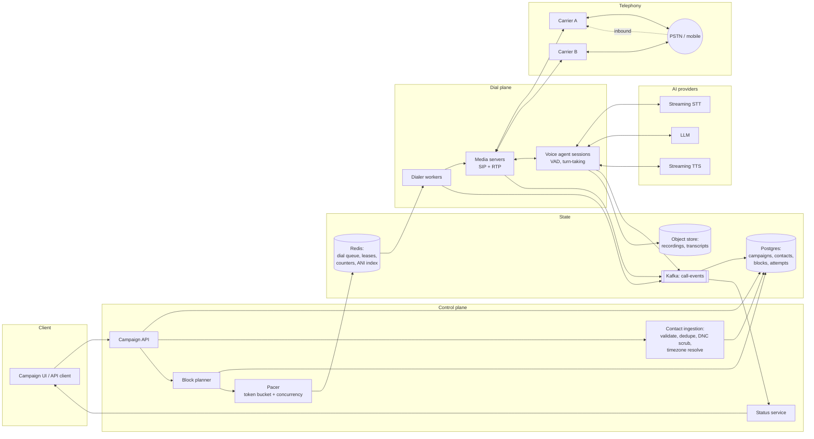
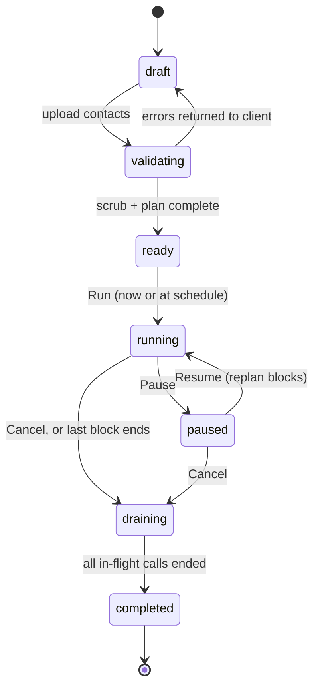
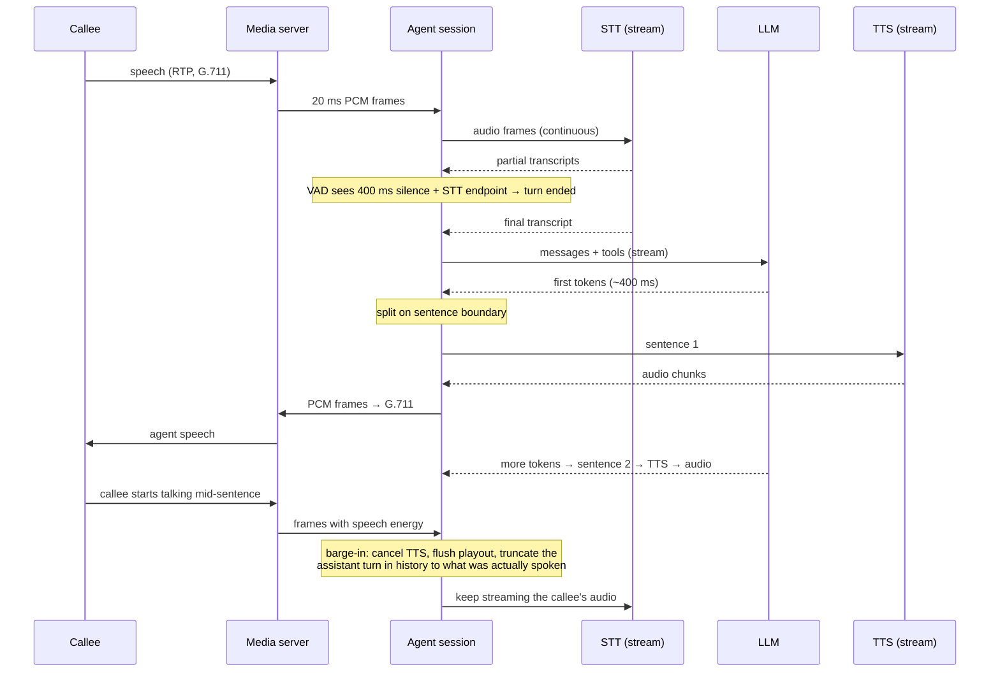

# Outbound AI voice campaign platform: system design

**One line:** A client uploads 100,000 mobile numbers, presses Run, and within four hours every number has been dialed once from the PSTN by an AI voice agent (speech-to-text, LLM, text-to-speech). Numbers that did not connect are retried in later four-hour blocks. Anyone who calls the number back reaches the same agent.

This document is the design. `INTERVIEW.md` is how to present it in 45 minutes and what interviewers score.

---

## Contents

1. [The numbers that drive everything](#1-the-numbers-that-drive-everything)
2. [Requirements](#2-requirements)
3. [Capacity estimation](#3-capacity-estimation)
4. [High-level architecture](#4-high-level-architecture)
5. [Campaign lifecycle and API](#5-campaign-lifecycle-and-api)
6. [Scheduler and pacer](#6-scheduler-and-pacer)
7. [Dialer and telephony](#7-dialer-and-telephony)
8. [The voice agent](#8-the-voice-agent)
9. [Inbound calls](#9-inbound-calls)
10. [Retry semantics](#10-retry-semantics)
11. [Data model](#11-data-model)
12. [Time to run](#12-time-to-run)
13. [Failure modes](#13-failure-modes)
14. [Monitoring, status, and alerting](#14-monitoring-status-and-alerting)
15. [Cost](#15-cost)
16. [Compliance and privacy](#16-compliance-and-privacy)
17. [Scaling past 100,000 and multi-tenancy](#17-scaling-past-100000-and-multi-tenancy)
18. [Build vs buy and rollout](#18-build-vs-buy-and-rollout)
19. [Trade-offs and rejected alternatives](#19-trade-offs-and-rejected-alternatives)

---

## 1. The numbers that drive everything

Everything in this design follows from five numbers. Memorize them.

| Quantity | Value | Where it comes from |
|---|---|---|
| Sustained dial rate | **8 calls/second** | 100,000 attempts in 3.5 h (keep 30 min of the 4 h block as tail margin). 100,000 / 12,600 s = 7.9 |
| Concurrent calls (channels) | **~540, provision 800** | Little's law: 8/s × 67 s mean channel hold time |
| Concurrent AI conversations | **~320, provision 500** | 8/s × 30% live answer × 135 s mean conversation |
| Agent response latency | **p50 ≤ 1.0 s, p95 ≤ 1.8 s** | Human tolerance for a pause in conversation; above ~2 s people say "hello?" or hang up |
| Cost per 100k-contact campaign | **$2.7k to $14k** (3 attempt blocks) | Telephony and TTS dominate; the LLM is under 5% |

The bottleneck is not the database (8 writes/second is nothing). The bottlenecks are carrier calls-per-second limits, concurrent AI session capacity, and the legal calling window. An interviewer who hears you identify those three in the first five minutes knows you have built something like this.

---

## 2. Requirements

### Functional

1. A client creates a campaign: a contact list (up to 100,000 mobile numbers with per-contact metadata), a conversation script and goal, a schedule or an on-demand Run button.
2. When run, the system dials every eligible contact once within a 4-hour block.
3. Each call is handled end to end by an AI agent: streaming STT, an LLM holding the conversation, streaming TTS back to the callee.
4. Calls that fail to connect (no answer, busy, voicemail, network failure) are eligible for retry in the next block, subject to a policy (max attempts, outcome class, legal frequency caps).
5. Inbound: a callee who returns the call reaches our system, is recognized by their number, and talks to the same agent with campaign context. Unknown inbound callers get a generic greeting and an opt-out path.
6. The client sees live status: progress, outcomes, estimated completion, retry queue, cost so far, per-call transcripts and dispositions.
7. The client can pause, resume, and cancel a running campaign without cutting off live conversations.

### Non-functional

| Requirement | Target |
|---|---|
| Block completion | All eligible contacts attempted within the 4 h block, 99% of runs |
| No double dial | Zero cases of the same contact dialed twice in one block (compliance invariant) |
| Agent turn latency | p50 ≤ 1.0 s, p95 ≤ 1.8 s from end of callee speech to start of agent audio |
| Availability of control plane | 99.9% (campaign API, status) |
| Durability | No attempt or outcome lost; every call has a record with its final state |
| Audio quality | PSTN narrowband (8 kHz G.711); MOS ≥ 3.8 on our leg |
| Calling-hours safety | Zero calls outside the legal local window (8am to 9pm local; stricter where state law says) |

### Constraints that shape the design

- **Consent and DNC.** In the US, marketing calls to mobile numbers using an artificial or prerecorded voice require prior express written consent under the TCPA, and the FCC confirmed in 2024 that AI-generated voices count as artificial. The system therefore treats the contact list as pre-consented and scrubs it against the national Do Not Call registry and the client's internal suppression list anyway. The system is a tool; the legal exposure is real for the client and for us, so every opt-out is honored immediately and recorded.
- **Calling hours.** 8am to 9pm in the callee's local time federally; several states are narrower and cap attempts per day (Florida: three per 24 hours per subject). The scheduler plans against local time, and the dialer re-checks before every originate.
- **Caller ID must be real and callable.** The number shown must be one we own and answer. This is why inbound is a requirement, not a feature.
- **Carrier rate limits.** Carriers cap calls per second (CPS) per trunk and per account. Reaching 8 CPS sustained means negotiated limits or multiple trunks.
- **Caller-ID reputation.** A number that places thousands of calls a day gets labeled "Spam Likely" by the analytics engines carriers run, and answer rates collapse. STIR/SHAKEN attestation and a rotating pool of registered numbers are mandatory.

### Assumptions, stated

- US market, English, one tenant at a time for the capacity math; multi-tenancy is addressed in section 17.
- Outcome mix on first attempt: 30% live human, 25% voicemail, 35% no answer or busy, 10% failed (6% permanent such as invalid number, 4% transient such as carrier congestion). These are typical for consented B2C mobile outreach; the design parameterizes them and the pacer measures the real values live.
- Mean live conversation 2.5 minutes including ring time; the agent has a bounded goal (qualify, book, inform, confirm) and is prompted to be brief.

### Out of scope

Human agent handoff, SMS fallback, payments over the phone, non-US telephony. Each is an extension point, not a redesign.

---

## 3. Capacity estimation

Work the math aloud in an interview. It takes two minutes and it is where most candidates separate.

**Dial rate.** 100,000 attempts over a 4 h block is 6.9/s. Finishing in 3.5 h and reserving the last 30 minutes for in-block technical retries and the slow tail gives 8/s. The pacer uses this as the baseline and adjusts live (section 6).

**Channel hold time.** Weighted by the outcome mix:

| Outcome | Share | Hold time | Contribution |
|---|---|---|---|
| Live human | 30% | 150 s (15 s ring + 135 s talk) | 45.0 s |
| Voicemail | 25% | 45 s (ring + machine detection + 20 s message) | 11.3 s |
| No answer / busy | 35% | 30 s (ring to timeout) | 10.5 s |
| Failed | 10% | 5 s | 0.5 s |
| **Mean** | | | **67 s** |

**Concurrency.** Little's law: concurrent = arrival rate × mean hold time.

- Channels: 8/s × 67 s = 536 concurrent calls. Provision 800 to absorb a 50% swing in answer rate or talk time.
- AI sessions: only live answers consume STT, LLM, and TTS. 8/s × 0.30 × 135 s = 324 concurrent conversations. Provision 500.
- Audio bandwidth: G.711 is 64 kbps each way plus RTP overhead, call it 90 kbps per leg. 800 channels is ~72 Mbps each direction. Not a constraint.

**Storage per campaign.** 100,000 contacts × 3 attempts × ~1 KB per attempt row is 300 MB of relational rows worst case. Recordings: 50,000 live conversations × 135 s × 64 kbps × 2 legs ≈ 110 GB of raw G.711; compress to Opus at 24 kbps and it is ~40 GB. Transcripts: 50,000 × ~3 KB = 150 MB. Object storage holds recordings and transcripts; the database holds rows.

**Writes.** 8 attempts/s produce roughly 5 state transitions each (dialing, ringing, answered, agent turns, ended), so ~40 events/s, plus one LLM call per turn: 2.4 conversations start per second × 8 turns ≈ 20 LLM calls/s across the fleet. A single Postgres instance handles this with headroom to spare. Kafka is in the design for fan-out to consumers (metrics, billing, analytics), not for throughput.

**Inbound.** Assume 4% of attempted contacts call back within 24 hours, concentrated in the hour after the block. 100,000 × 4% = 4,000 callbacks; a peak of ~1,000/hour is 0.3/s × 120 s ≈ 35 concurrent. Provision 100 inbound channels.

---

## 4. High-level architecture



**Control plane** owns campaign state and decides *what* to dial *when*. It is a standard web service plus two long-running processes: the block planner (runs at campaign start and at each block boundary) and the pacer (runs continuously during a block, one leader per campaign).

**Dial plane** does the dialing and holds the calls. Dialer workers are stateless consumers of the dial queue. Media servers terminate SIP and RTP and are the only stateful part: a call lives on one media server for its duration. Voice agent sessions run beside the media server (same host or same availability zone, because every 20 ms audio frame crosses that boundary) and orchestrate the STT, LLM, and TTS streams for one call.

**State.** Postgres is the source of truth for campaign, contact, block, and attempt state. Redis holds the hot, short-lived things: the per-block dial queue, worker leases, concurrency counters, and the inbound ANI lookup index. Kafka carries every call event to the consumers that need it (status, metrics, billing, analytics). The object store holds recordings and transcripts.

**AI providers** are behind a thin internal gateway per modality so the vendor can be swapped or failed over without touching the agent. All three are streaming: audio in, text out for STT; text in, text out for the LLM; text in, audio out for TTS.

**Telephony** is at least two carriers from day one. Carrier outages and per-carrier CPS caps are both routine, and the second carrier is how you handle either.

---

## 5. Campaign lifecycle and API

A campaign moves through these states:



**Run** is the moment the client cares about. The block planner materializes blocks (section 6), the pacer leader for this campaign starts, and the first dial job leaves within seconds. **Pause** stops the pacer from releasing dial jobs; in-flight calls finish normally. **Resume** replans the remaining contacts into fresh blocks from now, because the old block boundaries are stale. **Cancel** drains: no new dials, live calls finish, and the campaign is marked completed with the undialed contacts recorded as `not_attempted`. Cutting off a live conversation is never an option the system offers.

### API surface

```
POST   /campaigns                         create (name, script, policy, schedule)
POST   /campaigns/{id}/contacts           upload CSV or JSON; async validation job
GET    /campaigns/{id}/validation         counts: accepted, duplicates, invalid, DNC-suppressed, no-consent
POST   /campaigns/{id}/run                start now (or honor the schedule)
POST   /campaigns/{id}/pause
POST   /campaigns/{id}/resume
POST   /campaigns/{id}/cancel
GET    /campaigns/{id}/status             the status document below
GET    /campaigns/{id}/attempts?cursor=   paginated attempt records
GET    /attempts/{id}                     one call: timeline, transcript, recording URL, disposition
POST   /webhooks/telephony/{carrier}      carrier status callbacks (signed)
```

### The status document

This is what the client's dashboard polls, and what "status" means when an interviewer asks.

```json
{
  "campaign_id": "cmp_8f3a",
  "state": "running",
  "current_block": { "index": 1, "starts_at": "...", "ends_at": "...", "elapsed_pct": 41 },
  "contacts": { "total": 100000, "eligible_this_block": 100000, "attempted_this_block": 43120 },
  "throughput": { "cps_target": 8.1, "cps_actual": 7.9, "concurrent_calls": 530, "concurrent_conversations": 318 },
  "outcomes_this_block": { "live": 12840, "voicemail": 10790, "no_answer": 15020, "busy": 410, "failed_transient": 1700, "failed_permanent": 2360 },
  "dispositions": { "interested": 3210, "not_interested": 7100, "callback_requested": 980, "opted_out": 640, "unclear": 910 },
  "retry_queue_next_block": 28220,
  "eta": { "block_complete_at": "...", "on_track": true, "confidence": "high" },
  "cost_so_far_usd": 612.40,
  "health": { "carrier_error_rate": 0.012, "agent_p95_latency_ms": 1420, "alerts": [] }
}
```

The status service builds this from Kafka consumers writing to Redis counters (sub-second freshness) and from Postgres for the slow-changing parts. It never queries the attempt table on the request path.

---

## 6. Scheduler and pacer

The scheduler answers two questions: which block does each contact belong to, and how fast do we release dials within a block so that we finish on time without exceeding any limit.

### Blocks are defined in the callee's local time

A naive design defines a block as a wall-clock window (10:00 to 14:00 Eastern). A national list breaks it: 10:00 Eastern is 7:00 Pacific, which is illegal to call. So a block is a local-time window, and the planner groups contacts into timezone cohorts. Block 1 for the Eastern cohort runs 09:00 to 13:00 ET; for the Pacific cohort it runs 09:00 to 13:00 PT, which is three hours later in wall-clock terms. The system is therefore dialing for about seven wall-clock hours per block on a national list, with a sliding mix of cohorts, and the per-cohort rate is that cohort's share of the list divided by 3.5 hours.

Timezone comes from the contact's address if provided, otherwise from the area code plus prefix with a known-ambiguous flag; ambiguous numbers are placed in the most conservative window where both candidate zones are legal.

With a legal window of 8am to 9pm local, three 4-hour blocks fit in a day: 09:00 to 13:00, 13:00 to 17:00, 17:00 to 21:00. The planner drops the 8:00 hour as margin and never schedules a block that ends after the legal window. A state frequency cap (three attempts per 24 hours) is enforced per contact by the planner and re-checked by the dialer.

### Why a block, and not "retry in 30 minutes"

The block is the retry spacing. Calling someone back twenty minutes after they did not answer is hostile and rarely changes the outcome; calling at a different time of day does. The block also gives the client a predictable statement: "everyone eligible will have been tried by 1pm their time." Block length is a campaign parameter; four hours is the default because it fits three attempts in a legal day.

### Pacing algorithm

The pacer's job is to finish the block's attempts about 30 minutes early while never exceeding four limits: carrier CPS, carrier concurrent channels, AI session capacity, and the block's remaining time. It runs a control loop once per second per campaign cohort:

```python
def pace_tick(block, cohort):
    remaining   = count_eligible_not_attempted(block, cohort)
    seconds_left = (block.end_at - TAIL_RESERVE) - now()
    if remaining == 0 or seconds_left <= 0:
        return 0

    needed_cps = remaining / seconds_left

    # How many new dials per second the AI pool can absorb right now.
    # Each dial becomes a conversation with probability answer_rate and holds a
    # session for avg_conv_seconds. Both are measured from the last 10 minutes.
    free_sessions   = MAX_AI_SESSIONS - active_ai_sessions()
    ai_absorb_cps   = free_sessions / (live_answer_rate() * avg_conv_seconds())

    free_channels   = MAX_CHANNELS - active_channels()
    channel_cps     = free_channels / avg_hold_seconds()

    target_cps = min(needed_cps * 1.15,        # 15% ahead of schedule
                     carrier_cps_cap(),        # sum across healthy carriers
                     ai_absorb_cps,
                     channel_cps)

    release = min(int(token_bucket.take(target_cps)), remaining)
    push_dial_jobs(block, cohort, n=release)
    emit_metric("pacer.target_cps", target_cps, needed=needed_cps, ai=ai_absorb_cps)
    return release
```

Three properties matter:

- **It catches up.** If a carrier outage stalls dialing for 20 minutes, `needed_cps` rises and the pacer dials faster afterward, up to the caps. If it cannot catch up, the status document's ETA shows `on_track: false` well before the block ends, and the overflow rolls into the next block as `not_attempted` (not as a failure, and not counting against the contact's attempt cap).
- **It protects the agent.** An answered call that has no AI session ready is a dead line for the callee. The `ai_absorb_cps` term throttles dialing before that happens. This is the voice-AI analog of the abandonment-rate control in a predictive dialer for human agents.
- **It measures rather than assumes.** Answer rate and talk time are read from the last ten minutes of real outcomes, so a campaign whose list answers at 50% does not blow past the session cap.

The pacer is a single leader per campaign (Redis lease with a 10-second TTL, heartbeat every 3 seconds). If it dies, another instance takes the lease and resumes from Postgres state. Nothing is lost because the pacer holds no state of its own; the queue and the counters are in Redis, the truth is in Postgres.

### Dial queue

Dial jobs go into a Redis stream per block and cohort (or a Kafka topic partitioned the same way; Redis is simpler and the volume is tiny). A job is `{attempt_key, contact_id, block_id, cohort, caller_id_hint}`. Workers claim jobs with a 60-second lease; an unacknowledged job is reclaimed. The job is a hint to dial, not the record of dialing. The record is the attempt row, and the attempt row is what makes dialing exactly-once (section 7).

---

## 7. Dialer and telephony

### Originating a call

A dialer worker claims a job and does the following, in this order, every time:

```python
def handle_dial_job(job):
    contact = load_contact(job.contact_id)

    # 1. Compliance re-check at the last possible moment (defense in depth).
    if not legal_to_call_now(contact):               # local hours, state caps, suppression list
        mark_job_deferred(job); return

    # 2. Claim the attempt. The unique index on (contact_id, block_id) is the
    #    exactly-once guarantee. If another worker already claimed it, we stop.
    attempt = db.execute("""
        INSERT INTO call_attempts (id, contact_id, block_id, attempt_no, state, claimed_at)
        VALUES (gen_ulid(), %s, %s, %s, 'dialing', now())
        ON CONFLICT (contact_id, block_id) DO NOTHING
        RETURNING id
    """, contact.id, job.block_id, contact.attempts + 1)
    if attempt is None:
        ack(job); return                               # duplicate job; already dialed this block

    # 3. Originate. Pass our attempt id as the carrier's client reference so every
    #    webhook comes back tagged with it.
    carrier = pick_carrier()                           # healthy, under its CPS cap, cheapest
    from_number = pick_caller_id(contact)              # same area as callee if possible, lowest daily use
    try:
        call = carrier.originate(to=contact.phone, from_=from_number,
                                 client_ref=attempt.id,
                                 answer_url=MEDIA_INGRESS, status_url=WEBHOOK_URL,
                                 ring_timeout_s=30, amd=True)
    except CarrierRejected as e:                       # 503, 429, trunk busy
        db.update(attempt, state='failed_transient', sip_code=e.code, carrier=carrier.name)
        if e.retryable and job.in_block_retries < 2:
            requeue(job, delay_s=5, prefer_other_carrier=True)
        ack(job); return

    db.update(attempt, provider_call_id=call.id, carrier=carrier.name, from_number=from_number)
    ack(job)
```

The order is what makes it safe. Write the attempt row first, then dial. If the worker dies between the insert and the originate, a reaper finds a `dialing` row with no `provider_call_id` after 2 minutes and marks it `failed_internal` (retryable in the next block). If the worker dies between the originate and the update, the carrier's first webhook arrives carrying `client_ref=attempt.id` and the webhook handler fills in the provider call id. If the carrier accepted the call but we never heard anything back, a reconciliation job queries the carrier by client reference every 5 minutes for stale `dialing` rows. There is no window in which the same contact can be dialed twice in a block, and no window in which an originated call goes unrecorded.

### Call progress and webhooks

Carriers send status events: `initiated`, `ringing`, `answered`, `completed` with a SIP code and duration, plus answering-machine-detection results if requested. Webhooks are at-least-once and may arrive out of order. The handler is idempotent on `(provider_call_id, event_type, sequence)` and applies a state machine that refuses backwards transitions (an `answered` arriving after `completed` is logged and dropped). Every event is appended to the `call-events` Kafka topic for downstream consumers after the attempt row is updated.

### Answering machine detection

AMD decides within 2 to 4 seconds of answer whether a human or a machine picked up. It is wrong 5 to 10% of the time, and the two errors are not symmetric:

- A human classified as a machine gets hung up on or hears a voicemail message. This is the worse error. Bias AMD toward "human".
- A machine classified as a human means the agent talks to a greeting until the tone, wasting ~30 seconds of STT and TTS. Mitigate by letting the agent detect the beep tone or a long uninterrupted monologue and switch to voicemail mode.

On a confirmed machine, policy decides: hang up and mark `voicemail` (retryable), or play a pre-rendered TTS message after the beep and mark `voicemail_left`. The message is rendered once per campaign, not per call.

### Caller-ID pool and reputation

Carrier-side analytics label numbers that dial heavily as "Spam Likely", and a labeled number's answer rate can fall from 30% to under 10%. The pool is managed as a reputation asset:

- A pool of several hundred DIDs per 100k-contact campaign, each capped at a few hundred outbound calls per day. The cap is a tunable; the metric that tunes it is per-DID answer rate relative to the pool mean.
- Numbers are registered with the carrier analytics providers (the Free Caller Registry covers the three major US analytics engines) and branded where the carrier supports it.
- Every call is signed with STIR/SHAKEN A-level attestation. This requires that the carrier knows we own the numbers, which is one reason to buy DIDs from the same carrier that originates the calls.
- A DID whose rolling answer rate drops more than 30% below the pool mean is pulled from rotation automatically and flagged for review.
- Local presence: prefer a caller ID in the callee's area code. It raises answer rates measurably, and it is legal as long as the number is ours and callable.

### Carrier abstraction

One internal interface: `originate`, `hangup`, `play`, `bridge_media`, `lookup_by_ref`, plus a normalized webhook schema. Two implementations behind it from day one (a CPaaS such as Twilio or Telnyx, and a SIP trunk into our own FreeSWITCH). A per-carrier circuit breaker opens on a 5xx or 503 rate above 5% over 60 seconds and routes to the other carrier. Carrier selection is weighted by health, remaining CPS headroom, and price.

---

## 8. The voice agent

The agent is one process per live call that owns the audio loop: receive 20 ms frames from the media server, decide when the callee has finished speaking, get a reply from the LLM, speak it, and handle being interrupted. The three AI vendors are stateless from the agent's perspective; the agent holds the conversation.

### One turn, end to end



### Latency budget

The target is under one second from the moment the callee stops talking to the moment they hear the agent start. Every stage streams, and nothing waits for a full result when a partial will do.

| Stage | Budget | How |
|---|---|---|
| End-of-turn detection | 300 to 500 ms | VAD silence threshold combined with the STT endpoint signal and a semantic check ("is this utterance complete?") for short pauses mid-sentence |
| STT final after end of speech | 100 to 300 ms | Streaming STT with 8 kHz mu-law input; partials arrive continuously, so the final is a flush |
| LLM time to first token | 300 to 600 ms | Small fast model; system prompt and script in the cached prefix; output constrained to one or two sentences per turn |
| TTS time to first audio | 100 to 300 ms | Streaming TTS fed sentence by sentence; first sentence is short by prompt design |
| Playout path | 100 to 200 ms | Jitter buffer, G.711 encode, RTP, carrier, handset |
| **Total** | **0.9 to 1.9 s** | Target p50 1.0 s, p95 1.8 s |

Tricks that buy back time, in order of value:

1. **Pre-render fixed speech.** The opening line, the identity disclosure, the opt-out confirmation, the voicemail message, and the closing are identical across tens of thousands of calls. Render each once per campaign, store the audio, and play from cache. The first thing the callee hears after "Hello?" is on the wire in under 300 ms instead of 1.5 s, and it is 30 to 40% of all spoken characters, so it is a cost lever too.
2. **Speak the first sentence while the model writes the second.** Split the LLM stream on sentence punctuation and hand each sentence to TTS as it completes.
3. **Keep turns short by prompt.** A one-sentence reply has a lower TTS first-byte and lower interruption cost.
4. **Acknowledge during long waits.** If a tool call (calendar lookup) will take over a second, play a pre-rendered "one moment" rather than silence.

### Turn-taking and barge-in

People interrupt. When speech energy appears while the agent is talking, the agent cancels the outstanding TTS request, flushes the playout buffer at the media server, and, critically, truncates the assistant message in conversation history to the words that were actually played. Without that last step the LLM believes it said things the callee never heard. The agent tracks played audio by character offset using the TTS word timestamps.

Over-eager barge-in is its own failure: background noise or a "mm-hm" should not cut the agent off. The interrupt threshold requires both speech energy above a floor for 200 ms and the STT producing a word.

### The conversation itself

The LLM receives a system prompt built from the campaign script: who we are, who we are calling and why, the goal, the three or four things it may offer, what it must never do (quote prices it was not given, promise outcomes, keep talking to someone who said no), and the required disclosures. It receives the contact's metadata, the attempt history ("this is a callback; they asked us to call after 5pm"), and a small tool set:

| Tool | Effect |
|---|---|
| `set_disposition(code, notes)` | Records the structured outcome (interested, not interested, callback requested, wrong number) |
| `schedule_callback(at)` | Creates a future attempt outside the block system, in the callee's window |
| `opt_out(reason)` | Writes the number to the suppression list synchronously, then the agent confirms aloud and ends the call |
| `transfer(reason)` | Out of scope here, but the slot exists for a human handoff |
| `end_call()` | Polite close, hang up |

Opt-out has a belt-and-braces path: the STT stream is also watched by a plain keyword matcher for "stop calling", "remove me", "do not call", and DTMF digit 9. If either path fires, the suppression write happens before the call ends, not after, so a crash cannot lose it.

Model choice: a small fast model (Claude Haiku 5.5 class) for the turn loop, because latency is the product and the conversation is bounded; a stronger model is justified for a post-call pass that summarizes the transcript and audits the disposition. Prompt caching matters: the system prompt and script are identical across all calls in a campaign, so they sit in the cached prefix and only the conversation history is paid at full price.

### Audio plumbing facts an interviewer may probe

- PSTN audio is 8 kHz, G.711 mu-law in North America. The STT model must support narrowband input natively; upsampling does not add information. TTS output is downsampled to 8 kHz before it hits the wire, so expensive high-fidelity voices are wasted beyond what survives the codec.
- Frames are 20 ms (160 samples). The agent session should live in the same availability zone as the media server; a cross-region hop adds 30 to 80 ms per direction to every frame.
- Echo: the callee's handset leaks the agent's voice back into the microphone. Media servers run acoustic echo cancellation on the inbound leg or VAD will trigger on the agent's own speech.

---

## 9. Inbound calls

Every caller ID we display is a DID we own, and the law requires that calling it back reaches something meaningful. Inbound is therefore the same agent with a different entry point.

**Routing.** The carrier delivers an inbound INVITE for one of our DIDs to a media server. The server answers, and the agent session looks up the caller's number (ANI) in a Redis index populated on every outbound attempt: `ani:{e164} → {campaign_id, contact_id, last_attempt_id, last_outcome}`, TTL 30 days. A hit means a known contact calling back; the agent opens with context ("Thanks for calling back, this is ... about ..."). A miss means an unknown caller, a spoofed number, or a contact outside the TTL; the agent opens generically, offers to help, and offers opt-out.

**Capacity.** Inbound is small and bursty: roughly 4% of attempted contacts call back, most within the hour after the block. Provision 100 inbound channels and let the same agent session pool serve them; inbound sessions are counted against the same `MAX_AI_SESSIONS` so the pacer slows outbound if callbacks spike.

**Rules that differ from outbound.** Inbound calls are not subject to calling-hours restrictions (the callee initiated) and do not count as attempts against the contact. Opt-out requested on an inbound call suppresses the contact exactly as on outbound. Inbound outside the agent's operating hours (if the client sets any) gets a pre-rendered message and an opt-out prompt.

**Caller-ID protection.** Because our DIDs are public, they attract junk: robocalls, fax machines, misdials. Rate-limit per ANI, drop fax tones, and never let inbound volume starve outbound sessions (separate ceilings, shared pool).

---

## 10. Retry semantics

"If one of them fails, there's a chance for that call to be retried in the next four-hour block." The design turns that sentence into a classification and a policy.

### Outcome classification

| Outcome | Signal | Class | Retry? |
|---|---|---|---|
| Live conversation completed | Agent set a disposition | `completed` | No |
| Live, callee requested callback | `schedule_callback` tool | `callback` | Yes, at the requested time, outside blocks |
| Live, opt-out | `opt_out` tool or keyword or DTMF 9 | `suppressed` | Never; added to suppression list |
| Live, hung up within 5 s | Short duration, no disposition | `hangup_early` | Once, next block (counts as attempt) |
| Voicemail, message left | AMD machine + beep + message played | `voicemail_left` | Yes, next block, no second message |
| Voicemail, no message | AMD machine, policy says hang up | `voicemail` | Yes, next block |
| No answer | Ring timeout (SIP 480 / timer) | `no_answer` | Yes, next block |
| Busy | SIP 486 | `busy` | Yes, next block |
| Carrier congestion / network | SIP 503, 500, 408, timeout | `failed_transient` | Immediately on other carrier (max 2 in block), then next block |
| Invalid or unallocated number | SIP 404, 484, 604 | `failed_permanent` | Never |
| Call rejected by callee | SIP 603 | `rejected` | Once, next block |
| Fax or modem | Tone detection | `failed_permanent` | Never |
| Internal failure | Worker crash, media server loss, AI outage mid-call | `failed_internal` | Yes, next block; does not count against the contact's attempt cap |
| Not attempted | Block ended before dial | `not_attempted` | Yes, next block; does not count as an attempt |

### Policy

A contact is eligible for a retry in block N+1 when all of these hold:

1. The last outcome's class is retryable.
2. `attempts < max_attempts` (campaign default 3).
3. Attempts in the trailing 24 hours in the callee's jurisdiction are below the legal cap (3 in Florida, campaign-configurable, lowest applicable wins).
4. Block N+1 falls within the campaign's end date and the callee's legal window.
5. The contact is not on the suppression list (checked again at dial time).

"There's a chance" is exactly this: retry is the default for the retryable classes but is denied by any one of the caps. `failed_internal` and `not_attempted` are our fault, not the callee's, so they do not consume an attempt.

### Retries change the mix

People who did not answer once are less likely to answer the second time. The projection in section 12 uses 30% live on attempt one, 20% on attempt two, 15% on attempt three. The pacer does not need these numbers; it measures them. The cost model does.

---

## 11. Data model

Postgres, one schema per tenant or a `tenant_id` on every row with row-level security. The attempt table is the heart of it.

```sql
CREATE TABLE campaigns (
  id            TEXT PRIMARY KEY,                 -- ulid
  tenant_id     TEXT NOT NULL,
  name          TEXT NOT NULL,
  state         TEXT NOT NULL,                    -- draft|validating|ready|running|paused|draining|completed
  script_id     TEXT NOT NULL,
  policy        JSONB NOT NULL,                   -- max_attempts, block_hours, local_window, voicemail_mode, daily_cap
  scheduled_at  TIMESTAMPTZ,
  created_at    TIMESTAMPTZ NOT NULL DEFAULT now()
);

CREATE TABLE contacts (
  id               TEXT PRIMARY KEY,
  campaign_id      TEXT NOT NULL REFERENCES campaigns(id),
  phone_e164       TEXT NOT NULL,
  tz               TEXT NOT NULL,                 -- IANA zone
  tz_confidence    TEXT NOT NULL,                 -- address|area_code|ambiguous
  metadata         JSONB NOT NULL DEFAULT '{}',
  state            TEXT NOT NULL,                 -- pending|scheduled|in_progress|done|exhausted|suppressed|invalid
  attempts         INT  NOT NULL DEFAULT 0,
  last_outcome     TEXT,
  next_block_id    TEXT,
  UNIQUE (campaign_id, phone_e164)                -- dedupe at ingest
);

CREATE TABLE blocks (
  id            TEXT PRIMARY KEY,
  campaign_id   TEXT NOT NULL REFERENCES campaigns(id),
  index         INT  NOT NULL,                    -- 1, 2, 3 ...
  cohort_tz     TEXT NOT NULL,
  starts_at     TIMESTAMPTZ NOT NULL,             -- absolute, computed from local window
  ends_at       TIMESTAMPTZ NOT NULL,
  planned       INT  NOT NULL,
  state         TEXT NOT NULL                     -- planned|active|closed
);

CREATE TABLE call_attempts (
  id                TEXT PRIMARY KEY,
  contact_id        TEXT NOT NULL REFERENCES contacts(id),
  block_id          TEXT REFERENCES blocks(id),   -- null for callbacks and inbound
  attempt_no        INT  NOT NULL,
  direction         TEXT NOT NULL,                -- outbound|inbound
  state             TEXT NOT NULL,                -- dialing|ringing|answered|in_conversation|ended
  outcome           TEXT,                         -- the class from section 10
  disposition       TEXT,                         -- interested|not_interested|callback|opted_out|wrong_number|unclear
  carrier           TEXT,
  provider_call_id  TEXT,
  from_number       TEXT,
  sip_code          INT,
  amd_result        TEXT,
  claimed_at        TIMESTAMPTZ NOT NULL,
  answered_at       TIMESTAMPTZ,
  ended_at          TIMESTAMPTZ,
  talk_seconds      INT,
  cost_cents        INT,
  recording_url     TEXT,
  transcript_url    TEXT,
  agent_metrics     JSONB,                        -- turns, p50/p95 turn latency, barge_ins, llm_tokens, tts_chars
  UNIQUE (contact_id, block_id)                   -- THE exactly-once-per-block invariant
);
CREATE INDEX ON call_attempts (block_id, state);
CREATE INDEX ON call_attempts (provider_call_id);

CREATE TABLE suppression_list (
  tenant_id   TEXT NOT NULL,
  phone_e164  TEXT NOT NULL,
  source      TEXT NOT NULL,                      -- national_dnc|client_upload|opt_out_call|opt_out_inbound
  created_at  TIMESTAMPTZ NOT NULL DEFAULT now(),
  PRIMARY KEY (tenant_id, phone_e164)
);
```

**Invariants the schema enforces:** one attempt per contact per block; one contact per number per campaign; suppression is a set, not a flag on the contact, so it survives the campaign and applies across campaigns.

**What lives elsewhere.** Transcripts and recordings go to object storage under `tenant/campaign/attempt/`. The conversation history during a call lives in the agent process's memory, checkpointed to Redis every turn so a session can be resumed if the process restarts mid-call (the media server holds the call; a new agent session attaches). Per-turn events (`turn.started`, `stt.final`, `llm.first_token`, `tts.first_byte`, `barge_in`) go to Kafka with the attempt id as the key.

**Analytics.** A Kafka consumer copies `call-events` into ClickHouse (or a warehouse) for per-campaign reporting and per-DID reputation analysis. Postgres serves the operational queries; the warehouse serves "what was the answer rate by hour by area code last month."

---

## 12. Time to run

The client's question is "when will everyone have been reached?" The honest answer has two parts: when the first pass finishes, and how many passes it takes.

### One block

A block is 4 hours by definition; the pacer aims to finish attempts in 3.5. For a single-timezone list, wall-clock equals block. For a national list, cohorts stagger across three time zones and the campaign is actively dialing for about 7 wall-clock hours per block, each cohort within its own 4-hour local window.

### The campaign, block by block

Using the stated outcome mix, max 3 attempts, voicemail retried, message left on the first voicemail only:

| Block | Attempts | Live | Voicemail | No answer / busy | Failed permanent | Failed transient | Carried to next block |
|---|---|---|---|---|---|---|---|
| 1 | 100,000 | 30,000 (30%) | 25,000 | 35,000 | 6,000 | 4,000 | 64,000 |
| 2 | 64,000 | 12,800 (20%) | 19,200 | 26,900 | 3,200 | 1,900 | 48,000 |
| 3 | 48,000 | 7,200 (15%) | 14,400 | 23,000 | 2,400 | 1,000 | 0 (attempt cap) |
| **Total** | **212,000** | **50,000** | | | | | |

Half the list reaches a live conversation; the system places about 2.1 attempts per contact. Those two numbers drive the cost model and are what you quote to a client.

With a 09:00 start, three blocks (09:00 to 13:00, 13:00 to 17:00, 17:00 to 21:00 local) complete in one calendar day for every cohort. A campaign started at 14:00 fits only one block that day, because a block that would end after 21:00 is never scheduled; blocks 2 and 3 run the next morning and afternoon. If the client's jurisdiction mix includes a three-per-24-hour cap, the planner spaces block 3 into the next day for those contacts.

### Projected finish, computed live

```
eta_block_end = now + remaining_attempts / cps_actual_10min
on_track      = eta_block_end <= block.ends_at - TAIL_RESERVE
```

The status document carries this, and an alert fires when `on_track` flips false for more than 5 minutes (section 14). Confidence is "high" after the first 15 minutes of a block, when the measured answer rate and hold time have stabilized.

---

## 13. Failure modes

### Baseline failure rates to expect and to alert on

These are the rates a healthy run shows. The alert thresholds in section 14 are set relative to them, and a campaign that departs from them is telling you something about the list, the carrier, or the caller ID pool.

| Failure | Expected rate on a healthy run | Alert when |
|---|---|---|
| Permanent dial failure (invalid, unallocated, fax) | 5 to 7% of first attempts; near 0% on retries | > 10% on block 1 means a bad list |
| Transient carrier failure (503, 500, timeout) | 1 to 4% of attempts | > 5% over 60 s opens the carrier circuit breaker |
| Answering machine detection error | 5 to 10% of answered calls | Early-hang-up rate rising is the symptom |
| Internal failure (crash, media loss, AI outage mid-call) | < 0.1% of attempts | > 0.5% in 10 min |
| Webhook never delivered | < 0.1% of calls; recovered by reconciliation | Stale `dialing` rows > 50 |
| Duplicate dial job prevented | 0.01 to 0.1% of jobs (lease expiry races) | Any actual double dial: should be impossible; page |
| STT word error rate on 8 kHz telephony | 10 to 15% | "Didn't catch that" rate > 2× baseline |
| LLM tool-call or schema error | < 0.5% of turns | > 2% |
| Agent turn over 1.8 s | < 5% of turns | p95 > 1.8 s for 5 min |
| Call outside legal window | 0 | Any; page and pause |
| Opt-out without suppression row | 0 | Any; page |

### Failure modes and their owners

Every row here is something that has happened to a real dialer. The question in an interview is not whether you can list them but whether each has an owner in the design.

| Failure | Detection | Response | Contact impact |
|---|---|---|---|
| Carrier returns 503s at scale (congestion) | Per-carrier error rate > 5% over 60 s | Circuit breaker opens; traffic shifts to carrier B; pacer caps CPS to B's limit | None; in-block retry on B |
| Carrier down entirely | Health probe and error rate | Same, plus page if B is also degraded | None unless both down; then `not_attempted` rolls over |
| Caller ID labeled "Spam Likely" | Per-DID answer rate < 70% of pool mean over 500 calls | DID pulled from rotation; alert; replacement DIDs provisioned | Lower live rate until detected (minutes to an hour) |
| STT vendor outage | Error rate and latency on the STT gateway | Fail over to secondary STT; if both down, open the AI circuit breaker: pacer stops dialing, in-progress calls play a pre-rendered "we'll call back" and end as `failed_internal` | Retry next block, no attempt consumed |
| TTS vendor outage | Same | Fail over; fall back to a commodity voice; pre-rendered lines keep playing from cache | Voice quality dips |
| LLM outage or p95 latency > 3 s | Gateway metrics | Fail over to secondary model or provider; if none, same AI circuit breaker as STT | Retry next block |
| Media server crash | Lost heartbeat; carrier sends `completed` with cause | Calls on that host drop (unavoidable); attempts marked `failed_internal`; host removed from dialer rotation; autoscaler never drains a host with active calls | Retry next block, no attempt consumed |
| Agent session process dies mid-call | Media server loses the audio socket | Media server plays hold tone for up to 3 s while a new session attaches and loads history from Redis checkpoint; else ends call as `failed_internal` | Usually a 2 to 3 s pause |
| Dialer worker dies between claim and originate | Reaper finds `dialing` row with no provider id after 2 min | Mark `failed_internal`, requeue | Retry next block |
| Dialer worker dies between originate and record | Webhook arrives with `client_ref` | Handler fills in provider call id; nothing lost | None |
| Webhook delivery fails or arrives late | Reconciliation job polls carrier for stale `dialing`/`ringing` rows every 5 min | State corrected from carrier's record | Status lags by minutes |
| Duplicate dial job in queue | Unique constraint on `(contact_id, block_id)` | Second insert is a no-op; job acked; metric `dial.duplicate_prevented` increments | None. This is the invariant that must never break |
| Pacer leader dies | Redis lease expires in 10 s | Another pacer instance takes the lease, reads state from Postgres and Redis, continues | ~10 s pause in new dials |
| Pacer cannot reach required CPS (caps) | `on_track` false for 5 min | Alert; client-visible ETA updates; remainder rolls to next block as `not_attempted` | Delayed, not lost |
| Timezone misresolution | Dialer's `legal_to_call_now` re-check | Call deferred; metric `dial.deferred_window`; if rate > 0.1%, alert on ingestion quality | None (this is the whole point of the second check) |
| Call placed outside legal window | Should be impossible; audit query on `claimed_at` vs local window runs hourly | Page immediately; pause campaign | Legal exposure; this is a P0 |
| Opt-out not recorded | Should be impossible; suppression write precedes hangup | Audit: every `opted_out` disposition has a suppression row | Legal exposure; P0 |
| Postgres primary fails over | Connection errors for ~30 s | Workers retry with backoff; pacer pauses releases; no in-flight call is affected because media does not touch the DB | ~30 s pause in new dials |
| Redis loss | Queue and counters gone | Rebuild queue from Postgres (`eligible and not attempted`); counters recomputed from active attempts; ANI index rebuilt from last 30 days of attempts | Minutes of reduced status accuracy |
| Client uploads the same list twice | Unique `(campaign_id, phone_e164)`; cross-campaign duplicate check surfaces a warning | Dedup at ingest; validation report shows the count | None |
| Runaway cost (answer rate or talk time far above plan) | Cost-so-far vs. projection, per campaign | Soft alert at 120% of projection, hard pause at a client-set ceiling | Campaign pauses; client decides |

**Graceful shutdown is a feature, not a detail.** Every component handles SIGTERM by finishing what it holds: dialer workers stop claiming and finish their current originate; agent sessions finish the call; media servers refuse new calls and drain. Kubernetes pod disruption budgets and a termination grace period of at least the max call length (say 15 minutes) make deploys invisible to callees.

---

## 14. Monitoring, status, and alerting

Three audiences read the telemetry: the client (campaign progress), the operator (is the platform healthy), and the engineer debugging one call. Design for all three.

### The unit of work is the attempt, and every attempt emits one event

Every attempt produces a single structured `attempt.ended` event with everything known about it: ids, carrier, SIP code, outcome, disposition, durations for each phase, agent metrics (turn count, per-turn STT/LLM/TTS latencies, barge-ins, tokens, TTS characters), cost components, and which caller ID and which vendors were used. Per-turn events add detail during the call. The attempt id is the trace id across dialer, media server, agent, and every vendor call; one query reconstructs one call.

### Service-level indicators

| Area | SLI | Why it matters |
|---|---|---|
| Pacing | Attempts/s target vs actual; `on_track`; retry queue depth | Finishing the block is the contract |
| Telephony | Answer-seizure ratio (ASR) per carrier and per DID; post-dial delay; SIP code distribution; channel utilization | ASR drop = reputation or carrier issue; PDD rise = carrier issue |
| Media | RTP packet loss, jitter, MOS estimate per call; echo-cancellation convergence | Bad audio makes STT wrong and callers hang up |
| Agent latency | End-of-speech to first agent audio, p50/p95/p99, decomposed into VAD, STT, LLM TTFT, TTS TTFB | The product |
| Agent quality | Hang-ups within 5 s of connect; "sorry, I didn't catch that" rate; barge-ins per minute; turns per conversation; LLM tool-call error rate | Early hang-ups mean the opening is wrong or the number is flagged; repeats mean STT is struggling |
| AI vendors | Error rate, latency, and quota headroom per vendor | Capacity planning and failover trigger |
| Compliance | Calls outside window (must be 0); opt-outs recorded vs. opt-out dispositions (must be equal); attempts per contact per 24 h max | Each is a lawsuit if wrong |
| Cost | Cost per attempt, per live conversation, per campaign vs projection; TTS characters per conversation; LLM tokens per turn | Levers in section 15 are visible only if these exist |
| Business | Live rate, disposition mix, callback rate, inbound rate | What the client actually bought |

### Alerts (pages in bold)

- **Any call outside the legal window.** Pause the campaign automatically.
- **Opt-out disposition without a suppression row.**
- **Zero dials for 60 s while the queue is non-empty and the block is active** (stall).
- **Both carriers degraded**, or AI circuit breaker open for > 2 minutes.
- Block `on_track` false for > 5 minutes.
- Per-carrier error rate > 5% (ticket), > 20% (page).
- Agent p95 turn latency > 1.8 s for 5 minutes.
- Per-DID answer rate < 70% of pool mean (automatic rotation plus ticket).
- Early-hang-up rate > 2× campaign baseline (opening line or reputation problem).
- Cost at 120% of projection.

### Dashboards

1. **Campaign (client-facing):** the status document rendered: progress bar, ETA, outcome donut, dispositions, cost, a feed of recent calls with transcripts.
2. **Platform (operator):** concurrency vs caps, CPS per carrier, ASR per carrier, SIP code heatmap, agent latency decomposition, vendor health, DID pool health.
3. **Call (engineer):** one attempt: timeline of events, audio waveform with turn boundaries, transcript aligned to audio, per-turn latencies, LLM prompt and response, vendor request ids.

### Testing the system

- Load: a SIP simulator (SIPp) plays the carrier, a synthetic callee bot answers with scripted speech at the planned mix; run at 2× target CPS before every release.
- Chaos: kill a media server mid-block in staging weekly; the `failed_internal` count must match the calls it held and nothing else must change.
- Compliance: an hourly audit query for window violations and unmatched opt-outs runs in production, forever.
- Quality: sample 1% of transcripts per campaign for a stronger-model review of disposition accuracy and script adherence.

---

## 15. Cost

Costs below use 2026 list prices in round numbers. The shape matters more than the cents: telephony and TTS dominate, the LLM is small, and the levers are in the first two.

### Per-conversation unit costs

| Component | Unit price (ballpark) | Per live conversation (2.25 min talk) | Notes |
|---|---|---|---|
| Telephony, outbound US mobile | $0.004 (wholesale SIP) to $0.014 (CPaaS list) per minute, billed in 60 s increments | $0.012 to $0.042 (3 billed minutes) | Unanswered calls are not billed; voicemail is 1 billed minute |
| Streaming STT | ~$0.0045 per minute | ~$0.010 | Narrowband streaming tier |
| LLM, small fast model | $0.10 per M input, $0.50 per M output (Claude Haiku 5.5 list) | ~$0.002 | ~8 turns × 2,200 input tokens (mostly cached prefix) + 60 output tokens |
| LLM, mid model, for comparison | $2 / $10 per M (Claude Sonnet 5.5 list) | ~$0.040 | 20× the small model; still less than telephony |
| TTS, premium voice | $0.10 to $0.20 per 1,000 characters at volume | $0.10 to $0.20 | ~1,000 characters spoken per conversation |
| TTS, commodity neural | ~$0.016 per 1,000 characters | ~$0.016 | Indistinguishable after G.711 for most listeners |
| Recording storage | ~$0.023 per GB-month | < $0.001 | Opus at 24 kbps, 90-day retention |

### Per campaign (100,000 contacts, 3 blocks, 212,000 attempts, 50,000 live)

| Component | Low (wholesale telephony, commodity TTS) | High (CPaaS, premium TTS) |
|---|---|---|
| Telephony: 50,000 live × 3 min + 58,600 voicemails × 1 min = 208,600 billed minutes | $830 | $2,920 |
| STT: 50,000 × 2.25 min = 112,500 min | $510 | $510 |
| LLM (small model) | $100 | $100 |
| TTS: 50,000 × 1,000 chars | $800 | $10,000 |
| Compute: ~3 media servers + ~6 agent pods + control plane, for ~20 wall-clock hours | $60 | $60 |
| Caller ID pool: 400 DIDs at ~$1/month, charged here as if the pool serves one campaign a month | $400 | $400 |
| Recordings and storage | $15 | $15 |
| **Total** | **~$2,700** | **~$14,000** |
| Per contact | $0.027 | $0.14 |
| Per live conversation | $0.054 | $0.28 |

### Levers, ranked by dollars saved

1. **Pre-render the fixed lines.** 30 to 40% of TTS characters are identical across calls. Saves $300 to $4,000 per campaign and is also the biggest latency win.
2. **Commodity TTS.** After the 8 kHz mu-law codec, a $0.016 voice and a $0.20 voice are hard to tell apart. A/B test it on early-hang-up rate before paying 10×.
3. **Own SIP trunks instead of CPaaS once volume justifies the ops.** 3× on telephony. Break-even is roughly when telephony spend exceeds one telecom engineer's cost.
4. **Reputation management.** Not a line item, but the largest hidden cost: a flagged pool halves the live rate, and the client pays for 212,000 attempts to get 25,000 conversations instead of 50,000.
5. **Prompt caching and short turns.** Already assumed in the LLM number; without caching the LLM line is 3 to 4× higher, still small.
6. **AMD accuracy.** Each machine misclassified as human costs ~30 s of STT and TTS; at 10% error on 58,000 voicemails that is ~$80 per campaign. Minor, but it also wastes AI sessions.

### Fixed monthly

Control plane, databases, Kafka, Redis, two warm media servers, and monitoring run $1,500 to $3,000 a month at this scale before any campaign runs. Vendor minimum commitments (STT, TTS) are the other fixed line and are negotiated against projected minutes.

---

## 16. Compliance and privacy

This section exists because an interviewer for a telephony role will ask, and because a candidate who volunteers it signals they have shipped one of these. The rules below are design constraints; the exact legal text changes and is for counsel.

- **Consent.** Marketing calls to mobile numbers with an artificial voice require prior express written consent (TCPA). The system stores a consent record reference per contact and refuses to dial contacts without one when the campaign is marked as marketing.
- **Do Not Call.** Scrub against the national registry (refreshed at least every 31 days) and the client's internal suppression list at ingest and again at dial time.
- **Calling hours.** 8am to 9pm callee local time federally; stricter state windows and daily caps are encoded as a jurisdiction table consulted by both planner and dialer.
- **Identification and disclosure.** The agent states who is calling, on whose behalf, and the purpose at the start of the call. Where state law requires disclosing that the caller is an automated system or AI, that line is in the pre-rendered opening.
- **Opt-out.** Honored during the call, recorded synchronously, and applied across all of the tenant's campaigns. Opt-out requests must be processed promptly (the FCC's 2024 rule shortened the window to 10 business days; our design makes it immediate).
- **Callable caller ID.** Every displayed number is ours and reaches the agent or an opt-out IVR.
- **STIR/SHAKEN.** All outbound calls carry A-level attestation.
- **Recording consent.** Several states require all-party consent to record. The agent announces recording in those states, or recording is disabled per jurisdiction. Recording and transcript retention default to 90 days with per-tenant override.
- **PII.** Phone numbers, transcripts, and recordings are personal data: encrypted at rest and in transit, tenant-scoped access, audit log on every read of a recording or transcript, deletion on request propagated to object storage.
- **Prompt injection via the callee.** The callee is an untrusted input to the LLM. The agent's tools are narrow and idempotent, the model cannot change its own goal, and anything the callee says is quoted in the transcript, never executed.

---

## 17. Scaling past 100,000 and multi-tenancy

**Multi-tenancy at this scale.** Ten clients running 100k campaigns in the same window is 80 CPS and 8,000 channels. The architecture does not change; the limits do. The pacer becomes a two-level scheduler: a global allocator hands each campaign a CPS and session budget (fair share, weighted by plan tier), and each campaign's pacer runs within its budget. Carrier CPS is a shared pool with per-tenant floors. Caller ID pools are per tenant (reputation is a shared fate otherwise).

**To 1 million contacts per block (70 CPS, ~5,000 channels, ~3,000 AI sessions).** Media servers scale horizontally (10 to 12 hosts). AI vendor concurrency quotas become the binding constraint before anything in our stack does; this is where contracts are negotiated or STT and TTS are self-hosted on GPUs. Postgres is still fine for the control plane at 350 events/s, but partition `call_attempts` by campaign and archive closed campaigns to the warehouse. Kafka partitions by campaign.

**To 10 million (700 CPS).** Multiple carriers across regions, each with its own trunk capacity; a regional dial plane per US region with the control plane staying central; the dial queue moves from Redis to Kafka for durability at that fan-out; the status service aggregates from per-region counters. The exactly-once invariant stays in Postgres because it must be a single source of truth per contact per block, and 700 inserts/s is still comfortable.

**What does not scale linearly and must be planned.** Caller ID pool size (reputation caps calls per number per day, so DIDs grow with daily volume, and so does the number-registration work). Legal windows (the window does not get longer; 10 million contacts in a 4-hour block is only possible if the list spans time zones). Human review of transcripts for quality (sample, do not read everything).

---

## 18. Build vs buy and rollout

**Telephony.** Start on a CPaaS (Twilio, Telnyx, Vonage) with media streaming over WebSocket. It handles SIP, STIR/SHAKEN, number provisioning, and webhooks, and gets a working system in weeks. Put the carrier interface in from day one. Move high-volume traffic to owned SIP trunks (FreeSWITCH or a Kamailio and RTPEngine stack in front of wholesale carriers) when telephony spend justifies a telecom engineer. Keep the CPaaS as carrier B.

**Voice agent orchestration.** The VAD, turn-taking, barge-in, and vendor streaming plumbing is where the engineering time goes, and open frameworks (LiveKit Agents, Pipecat) or hosted voice-agent platforms (Vapi, Retell) already do it. Build on one of the open frameworks: the turn-taking behavior is the product and will need tuning the hosted platforms do not expose.

**AI vendors.** Two of each from day one behind the gateway. Pick the primary by measured latency on 8 kHz audio, not by benchmark.

**Phased rollout.**

1. One carrier, one vendor each, 1,000-contact campaigns to internal and consenting test numbers; measure latency and AMD accuracy for real.
2. Second carrier and vendor failover; chaos tests; the compliance audit queries running in production.
3. 100k campaigns for one design-partner client; reputation management live; cost model validated against invoices.
4. Multi-tenant pacer; self-serve.

---

## 19. Trade-offs and rejected alternatives

**Blocks as local-time windows vs. one wall-clock block.** Wall-clock is simpler and wrong for a national list. Local-time cohorts cost a planner that understands time zones and a dial plane that runs seven wall-clock hours per block. Chosen: local time.

**Postgres unique constraint vs. distributed lock for exactly-once dialing.** A Redis lock is faster and loses on failover; a unique index is slower by a millisecond and cannot be wrong. The dial rate is 8/s. Chosen: the constraint, with Redis only as a hint queue.

**Redis streams vs. Kafka for the dial queue.** Kafka is durable and partitioned; Redis is simpler and the queue can be rebuilt from Postgres in seconds. At 8/s the durability does not buy anything. Chosen: Redis for the queue, Kafka for the event firehose that many consumers read. Revisit at 100+ CPS.

**Agent session co-located with the media server vs. a separate fleet.** Separate fleets scale independently; co-location saves 30 to 80 ms per audio frame direction. Latency is the product. Chosen: same host or same zone, scaled together.

**Small fast LLM vs. the most capable model.** The capable model is 20 to 40× the cost and 2 to 3× the first-token latency. The conversation is bounded by a script and the first-token latency is user-visible on every turn. Chosen: small model in the loop, capable model for post-call summary and quality audit.

**Premium TTS vs. commodity.** The codec destroys most of the difference. Chosen: commodity by default, A/B tested per campaign on early-hang-up rate, premium as a client option.

**Leave voicemail vs. hang up on machines.** Leaving a message costs one billed minute and TTS, and raises callback rate; some clients dislike it. Chosen: campaign parameter, default leave once.

**Hard ETA promise vs. "on track" indicator.** A hard promise fails the first time a carrier wobbles. Chosen: a live ETA with a confidence level and rollover of the remainder, stated plainly to the client.

**Predictive over-dialing vs. capacity-bounded pacing.** Human-agent dialers over-dial and accept some abandoned calls. With AI agents there is no reason to connect a call we cannot serve; the pacer's `ai_absorb_cps` term bounds dialing to session capacity. Abandonment rate should be zero, and that is both better for callees and simpler to reason about.
