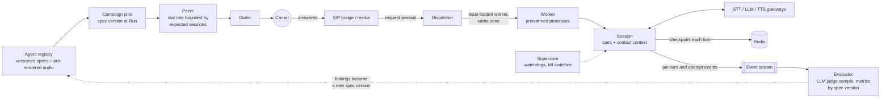
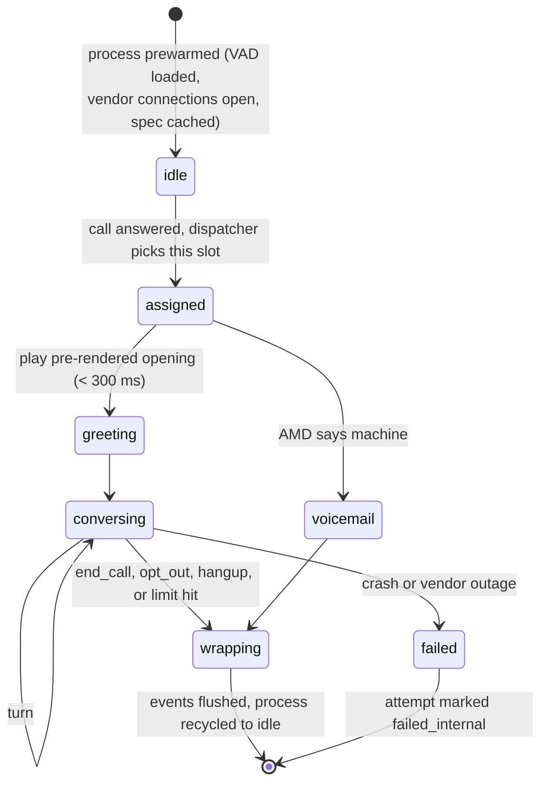

# Software stacks, and how the AI agents are managed

**Recommendation:** build on Stack B. That means renting telephony from two CPaaS carriers and running the voice agents yourself on LiveKit Agents, with best-of-breed streaming STT and TTS and a small fast LLM. It is the stack to present in the interview and the one to build version 1 on. Stack A is a one-week demo. Stack C is where telephony moves once its spend justifies a telecom engineer. Stack D fits a client that is already all-in on AWS and can accept coarser turn-taking.

The second half of this document covers agent management. It applies to every stack, and the last table shows where each stack puts each piece.

---

## The four stacks at a glance

| | A. Buy the agent | B. Own the agent, rent the pipes | C. Own the pipes | D. One cloud |
|---|---|---|---|---|
| Telephony | Twilio | Two CPaaS SIP trunks (Telnyx, Twilio) | Wholesale SIP carriers + Kamailio + FreeSWITCH | Amazon Connect |
| Agent runtime | Hosted voice platform (Vapi, Retell) | LiveKit SIP + LiveKit Agents (self-hosted or Cloud) | Your own workers, media forked over WebSocket | Connect flows + Lex + Lambda |
| STT / LLM / TTS | Chosen inside the platform | Deepgram / Claude Haiku 5.5 / Cartesia or ElevenLabs | Self-hosted on GPUs, LLM by API | Transcribe / Bedrock (Claude) / Polly |
| Time to first real call | Days | 2 to 4 weeks | 3 to 6 months | 1 to 2 weeks |
| Control over turn latency | The knobs the vendor exposes | Full | Full | Limited |
| Cost per live conversation | Highest | Middle | Lowest | Middle to high |
| Operations burden | Lowest | Medium | Highest | Low |
| Lock-in | High | Low | Lowest | Highest |
| Compliance features built in | Some | You build them | You build them | Most |
| Interview signal | Weak: "what does Vapi do inside?" is the next question | Strong | Strong, if you can defend the build time | Fair |

---

## Stack A: buy the agent

| Layer | Choice |
|---|---|
| Telephony | Twilio numbers and outbound calling |
| Voice agent | Vapi or Retell: hosted STT, LLM, and TTS orchestration, turn-taking, and barge-in |
| Control plane | TypeScript on a managed platform; Postgres (Neon or Supabase); queue on SQS or BullMQ |
| Observability | Vendor dashboards plus your own webhook-fed event store |

**Pros**
- A working call in days. Turn-taking, barge-in, interruption handling, and vendor integrations are already built.
- Session scaling is the vendor's problem.
- Swapping the STT, LLM, or TTS vendor is a configuration change.

**Cons**
- The per-minute platform fee dominates at this volume. One campaign has about 112,500 talk minutes. A fee of 5 to 10 cents a minute adds $5,600 to $11,000, which is more than the whole low-end cost of Stack B. Check current pricing; the shape of the problem holds regardless.
- Concurrency limits are set by your plan. 500 concurrent sessions is a contract negotiation, not a setting.
- You tune turn-taking only through the knobs the vendor exposes. Latency is the product, and here you do not own it.
- Recordings and transcripts pass through one more data processor, which adds a data processing agreement and a question about where recordings are stored.

**Keep this on your side:** the attempt row and its unique index. Write it before you ask the vendor to place the call, and pass the attempt id as call metadata. The exactly-once guarantee must not depend on the vendor.

**Choose it when** you need a demo for a design partner in a week, or you want to validate the script and answer rates before building anything.

---

## Stack B: own the agent, rent the pipes (recommended)

| Layer | Choice | Why this one |
|---|---|---|
| Telephony | Telnyx and Twilio Elastic SIP Trunking, both active | Two carriers from day one for failover and summed CPS; both sign STIR/SHAKEN for numbers bought from them |
| SIP to media | LiveKit SIP | Bridges each phone call into a LiveKit room, so the agent sees ordinary audio tracks |
| Agent runtime | LiveKit Agents (Python) | Worker registration, load-based dispatch, prewarmed processes, Silero VAD, and a turn-detection model are built in. This is the agent management layer you would otherwise write |
| STT | Deepgram streaming, a second vendor as fallback | Low latency on 8 kHz telephony audio, endpointing signal included |
| LLM | Claude Haiku 5.5 on the Anthropic API; the same model on Bedrock as fallback | Small, fast, cheap. Falling back to the *same* model on another cloud keeps behavior identical during an outage |
| TTS | Cartesia or ElevenLabs Flash for the conversation; a commodity voice as fallback | Low first-byte latency. Fixed lines are pre-rendered once per campaign |
| Post-call analysis | Claude Sonnet 5.5 through the Message Batches API | Summaries and disposition audits are not latency-sensitive, and batch processing is half price |
| Control plane | Go for the pacer, dialer, and webhook handlers | Cheap concurrency, single binary, no garbage-collection pauses that matter |
| State | Postgres, Redis, Redpanda (Kafka-compatible), S3 | As in the design: truth, hot state, event fan-out, recordings |
| Analytics | ClickHouse | Answer rates by hour and area code, per-DID reputation |
| Infrastructure | Kubernetes (EKS), one region, agent workers in the same zones as LiveKit media | Every 20 ms audio frame crosses that boundary |
| Observability | OpenTelemetry traces keyed by attempt id, Prometheus, Grafana | One trace per call across every component and vendor |

**Pros**
- You own turn-taking, endpointing, barge-in, and the latency budget, which is the part that is the product.
- No per-minute platform fee if you self-host LiveKit. LiveKit Cloud is a paid option if you would rather not run it.
- Every AI vendor is swappable behind a thin gateway. You pick each one by measured latency on telephony audio.
- LiveKit's dispatch, load reporting, and prewarmed process pool solve most of the agent fleet problem described below.

**Cons**
- You operate LiveKit server and LiveKit SIP, or pay for LiveKit Cloud.
- Two languages: Go for the control plane, Python for the agents. The frameworks and AI SDKs are Python-first, so the agents stay in Python. At 8 calls per second, Python everywhere would also work. Go earns its place only if the control plane grows past one team.
- One process per call isolates failures but costs memory. Find slots per node by load test, not by guessing.
- You own answering machine detection: use carrier AMD, or detect beeps and monologues in the agent.

**Variant B′: Pipecat instead of LiveKit Agents.** Pipecat composes the pipeline from frame processors and can take Twilio or Telnyx media streams over WebSocket directly, with no SIP bridge. It is a strong pipeline library. It does not give you worker dispatch, so you build the fleet layer yourself, as in Stack C. Choose it if pipeline flexibility matters more than fleet management.

**Choose it when** you are building version 1 for real, which is the situation the interview describes.

---

## Stack C: own the pipes

| Layer | Choice |
|---|---|
| Telephony | Wholesale SIP from two or more carriers (Bandwidth, Telnyx, others) |
| SIP edge | Kamailio: load balancing, per-carrier CPS limiting, failover |
| Media | FreeSWITCH: RTP, recording, AMD, and audio forked to agent workers over WebSocket |
| Agent runtime | Your own dispatcher and worker fleet; the audio loop in Go or Rust, or Pipecat in Python |
| STT / TTS | Self-hosted on GPUs (NVIDIA Riva or Parakeet-class STT; open-weights TTS), vendor APIs as overflow |
| LLM | Still an API at this scale; self-hosting a small model with vLLM only once GPU utilization justifies it |
| Control plane | Go, the same as Stack B |

**Pros**
- The lowest cost per minute. Wholesale telephony runs roughly a third of CPaaS list price, with no per-minute platform or vendor fees for STT and TTS.
- Audio and transcripts never leave your infrastructure.
- The highest ceiling. Nothing between you and the carrier has a quota.

**Cons**
- You need telecom engineers: SIP, RTP, NAT traversal, codecs, carrier interconnects, STIR/SHAKEN certificates. This expertise is scarce, and outages here are hard to debug.
- You need a GPU fleet and the people to run it. Self-hosted STT and TTS often trail the best vendors on 8 kHz audio. Measure before committing.
- Months before the first production call.
- You build dispatch, warm pools, and draining yourself.

**Choose it when** telephony plus STT and TTS spend clearly exceeds the cost of the team to run it. Migrate one carrier's traffic at a time, and keep a CPaaS as carrier B permanently.

---

## Stack D: one cloud

| Layer | Choice |
|---|---|
| Telephony and dialing | Amazon Connect with outbound campaigns: agentless dialing, AMD, calling-hours controls |
| Conversation | Lex V2 bots or Connect's AI agent features, with Bedrock (Claude) for responses |
| Speech | Transcribe and Polly |
| Tools and control plane | Lambda, Step Functions, DynamoDB |

**Pros**
- Dialing, AMD, and calling-hours compliance are built in rather than built by you.
- One vendor, one bill, one compliance program. That matters to enterprise and healthcare buyers.
- Minimal infrastructure to run.

**Cons**
- Lex-style bots process discrete turns rather than a continuous two-way audio stream. Latency and barge-in are less controllable than in a streaming framework. AWS ships quickly, so verify this against the current Connect feature set before ruling it out.
- Per-minute Connect fees, and service quotas to raise for 500 concurrent calls.
- Fewer voice choices, and the deepest lock-in of the four.

**Choose it when** the buyer mandates AWS, or compliance features matter more than conversational polish.

---

# How the AI agents are managed

"Agent" means three different things in this system, and each is managed differently.

1. **The agent definition** says what the agent says and what it may do. It is a versioned file, managed like code.
2. **The agent session** is one running conversation, created when a live human answers and destroyed at hangup. There are about 50,000 per campaign and about 320 at once.
3. **The agent fleet** is the set of worker processes that host the sessions. It is managed like any stateful service, except that its unit of capacity is a session slot rather than CPU.

No agent lives longer than a call. Anything that must persist between calls is stored outside the agent: the contact's history, the callback time, the opt-out. A session that crashes loses nothing that the next session cannot reload.



## 1. The agent definition: an immutable, versioned spec

Everything that shapes an agent's behavior lives in one file, kept in git and published to a registry. A published version never changes.

```yaml
agent_spec: renewal-outreach
version: 14
model:
  primary:   { provider: anthropic, id: claude-haiku-5-5, effort: low }
  fallback:  { provider: bedrock,   id: anthropic.claude-haiku-5-5 }
  max_output_tokens: 120            # one or two sentences per turn
stt: { primary: deepgram, fallback: vendor-b, language: en-US, endpointing_ms: 400 }
tts: { primary: cartesia, voice: "warm-female-1", fallback: commodity-neural }
turn_taking:
  vad_silence_ms: 400
  barge_in_min_speech_ms: 200
  use_semantic_turn_detector: true
system_prompt: prompts/renewal-outreach/v14.md     # templated with contact metadata
tools: [set_disposition, schedule_callback, opt_out, end_call]
prerendered:                         # rendered once at publish, stored as audio assets
  opening: "Hi, this is Ava, an automated assistant calling for {client} about your {product} renewal."
  hold: "One moment."
  optout_confirm: "Understood. You won't get any more calls from us. Goodbye."
  voicemail: "Hi, this is Ava calling for {client} ..."
limits: { max_call_s: 600, max_turns: 40, max_silence_s: 15, llm_turn_timeout_ms: 3000 }
disclosures: [identity, ai_disclosure_where_required, recording_where_required]
```

**Lifecycle.** A spec moves from draft to evaluated to published. A campaign pins a spec version when the client presses Run. Editing a spec creates a new version; it never changes a running campaign behind the client's back. Switching a running campaign to a new version is an explicit action. It applies to new calls only, and calls in progress finish on the version they started with.

**The evaluation gate.** Publishing runs the spec against simulated callees. These are LLM-driven personas: interested, hostile, confused, silent, interrupts constantly, asks to opt out halfway, speaks another language, is a voicemail greeting. Most runs are text-only and cheap. A smaller set runs through the real audio pipeline to measure latency and barge-in. A rubric grades every run:

- Was the identity disclosure said?
- Was every opt-out honored, with the tool called?
- Did the agent invent a price, date, or promise that is not in the script?
- Was the disposition correct?
- Did turn latency stay within budget?

A version that regresses on any compliance item cannot be published. Pre-rendered audio is generated at publish time, so a spec version and its audio always match.

**A/B tests** assign contacts to one of two spec versions by a hash of the contact id. The comparison metrics are live-conversation rate, early hang-up rate, and disposition mix.

## 2. The session lifecycle



- **Idle.** A process waits with the VAD model loaded, connections to STT, LLM, and TTS open, and the campaign's spec and pre-rendered audio in memory. Assignment to first audio takes under 100 ms because nothing is loaded on the call path.
- **Assigned.** The session receives its context: the spec, the contact's metadata, the attempt history ("they asked us to call after 5pm"), and, for inbound calls, the caller-ID lookup.
- **Greeting.** The pre-rendered opening plays immediately. The LLM is not consulted for the first words.
- **Conversing.** Each turn runs through the streaming loop in the design. After every turn the session writes the conversation history to Redis under the attempt id. That checkpoint is what lets a replacement process pick the call up if this one dies.
- **Wrapping.** The session makes sure a disposition exists; if the model never set one, a small classifier sets it from the transcript. It uploads the transcript and recording, emits the attempt event, and queues the post-call summary for the batch job. Then the process returns to idle.

## 3. Dispatch and capacity

The pacer keeps dialing below what the fleet can absorb. It uses the measured answer rate and conversation length, as in section 6 of the design. Most dials never become sessions, so slots are not reserved per dial; that would waste 70% of them.

When a call is answered, the SIP bridge asks the dispatcher for a session. The dispatcher picks the least-loaded worker in the same zone that has a free slot, and the worker hands the call to an idle prewarmed process. In Stack B, LiveKit does this: workers register and report load, and jobs go to the workers that have capacity.

If no slot is free within 500 ms, the caller hears the pre-rendered "We'll call you back shortly" and the call ends as `failed_internal`, which does not count against the contact's attempts. This must be rare. Above 0.1% of answers it pages, because it means the pacer's capacity model is wrong.

**Slots per worker** come from a load test, not from a guess. Start the test at 10 to 25 sessions per 4-vCPU node and raise it until p95 turn latency starts to climb. The ceiling is usually CPU for VAD and turn detection, or memory for one process per call. The LLM, STT, and TTS run remotely and cost the worker almost nothing.

## 4. Scaling and deploys

- **Scale on slots, not CPU.** The autoscaler targets 70% slot utilization across the fleet.
- **Pre-scale before a block.** The pacer knows the planned dial rate for the next block. It asks for capacity ten minutes before the block starts, because a cold node and an image pull take minutes. Scaling reactively at block start means the first answered calls find no agent.
- **Scale down by draining.** A worker marked for removal stops accepting sessions and finishes the ones it holds. The termination grace period is longer than the longest allowed call. No call is ever cut off to shrink the fleet.
- **Deploy by canary.** New worker code takes 5% of new sessions first. Each session records both its worker code version and its spec version, so the dashboards compare turn latency, early hang-ups, and vendor errors between versions within minutes. Rolling back means draining the canary.

## 5. Supervision and guardrails

Every session runs under a watchdog with hard limits from its spec.

| Limit | Default | What happens |
|---|---|---|
| Call length | 10 min | Polite close from pre-rendered audio, then hang up |
| Silence from callee | 8 s, then 15 s | "Are you still there?" at 8 s; end the call at 15 s |
| Turns | 40 | Close; flag the transcript for review |
| Repetition | The agent says the same sentence twice | Close; flag the transcript. A looping agent is a prompt bug |
| LLM turn time | 3 s | Play "One moment," retry on the fallback model; end as `failed_internal` if that fails too |
| Tool call time | 2 s | Tell the model the tool failed; the model moves on |
| Tokens and TTS characters per call | 5× the campaign mean | Close; this catches runaway loops before they cost money |

**Kill switches** exist at three levels. *Campaign* stops new dials and lets calls finish. *Spec version* routes new sessions to the previous version, for when a prompt change misbehaves in production. *Global AI breaker* stops all dialing when a vendor is down everywhere.

**Guardrails are enforced in code, not requested in the prompt.**

- **Tools validate their inputs on the server.** `schedule_callback` refuses a time outside the callee's legal window, whatever the model asked for.
- **Opt-out has a second path.** A keyword matcher on the STT stream and a DTMF digit can trigger opt-out without the LLM. Both paths write the suppression row before the call ends.
- **The callee is untrusted input.** Their speech reaches the model as user content. The model cannot change its spec, its tools, or its limits, so "ignore your instructions" achieves nothing.

## 6. Watching the agents

Every session emits per-turn events and one attempt event, tagged with spec version and worker version (section 14 of the design lists the fields). Agent-specific views on top of those:

- **Per spec version:** live rate, early hang-up rate, disposition mix, opt-out rate, mean turns, p95 turn latency. A new version is judged by comparing these numbers against the version before it, not by reading transcripts.
- **LLM judge on a sample:** about 1% of conversations, scored by a stronger model with the same rubric as the evaluation gate. It runs through the batch API. Failing calls go to a human review queue.
- **Calls that always get human review:** any compliance rubric failure, a complaint, an opt-out after a long conversation, and any watchdog close.

Problems found here become a new spec version that passes the gate. Nobody edits a live agent.

---

## Where each stack puts each piece of agent management

| | A. Buy the agent | B. LiveKit Agents | C. Own the pipes | D. One cloud |
|---|---|---|---|---|
| Spec storage | Spec in git, synced to the vendor's "assistant" objects by API | Your registry: Postgres plus S3 for audio | Your registry | Connect flows, Lex bot versions and aliases, Bedrock prompts |
| Dispatch | Vendor | LiveKit worker registration and load-based dispatch | You build it: a dispatcher plus a worker registry in Redis | Connect |
| Warm pool | Vendor | LiveKit prewarmed idle processes | You build it | AWS-managed |
| Scaling | Vendor concurrency limit set by your plan | Kubernetes autoscaler on a slot metric, plus pacer pre-scale | Same as B | Service quotas |
| Watchdogs and limits | Partly vendor settings (max duration, silence timeout); the rest from webhooks | Your library inside the agent | Your library inside the agent | Flow timeouts and Lambda |
| Evaluation gate | You build it against the vendor API; each test call costs money | Simulated callees as text sessions or as LiveKit participants | Same as B | You build it |
| Per-turn latency data | Whatever the vendor reports | Everything | Everything | Coarse |

---

## Questions you will get about agent management

**"How do you change the prompt in the middle of a campaign?"**
Publish a new spec version through the evaluation gate, then switch the campaign explicitly. New calls get the new version and calls in progress finish on the old one. Every attempt records which version it ran, so the before-and-after comparison is a query.

**"What if an agent goes rogue or gets stuck in a loop?"**
The watchdog catches it: repetition, turn count, silence, and token budget all have hard limits. Tools enforce their own rules regardless of what the model asks. If a whole version misbehaves, the spec kill switch routes new calls to the previous version within seconds.

**"How many concurrent agents per machine?"**
Found by load test, scaling until p95 turn latency starts to climb. The models run remotely, so the per-session cost on the worker is VAD, turn detection, audio encoding, and the process itself.

**"What happens to a conversation if the worker dies?"**
The phone call lives on the media server, not the worker. The media server plays a hold tone, and a new process loads the turn checkpoint from Redis and continues. If that takes more than about 3 seconds, the call ends as `failed_internal` and retries next block without consuming an attempt.

**"Why not one long-lived agent per contact or per campaign?"**
Nothing in the conversation needs to outlive the call, and anything long-lived is state to lose. Context that must carry between calls lives in the contact record and the attempt history, and each session loads it at assignment.
